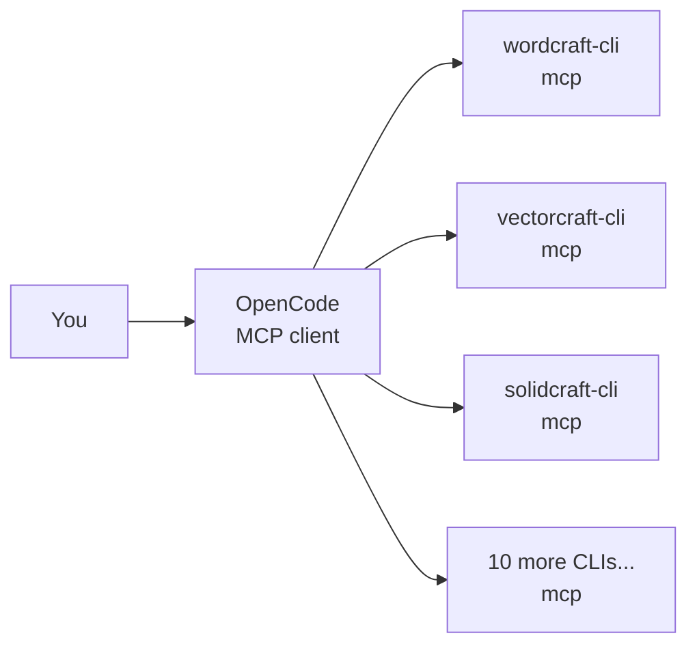

# ArtCraftMCP

> Drive your ArtCraft desktop apps with the OpenCode AI agent — over MCP.

[](https://github.com/storytold)
[](https://opencode.ai/docs/mcp-servers/)
[]()
[]()

**New here?** Install in under a minute: double-click `install-opencode-config.bat`, then run `opencode mcp list`. You should see 14 green checkmarks. If not, the [troubleshooting](#troubleshooting) section has you covered.

---

## What this is

OpenCode is an AI coding agent. ArtCraft apps (WordCraft, VectorCraft, SolidCraft…) each ship a headless CLI that can act as a **Model Context Protocol (MCP) server**. This repo wires them together: one portable `opencode.json` that registers every installed ArtCraft app as an OpenCode tool, plus a one-click installer that merges it into your personal config.



In short: **OpenCode finds your apps** — not the other way around. Each entry in `opencode.json` tells OpenCode which executable to launch and which folders it may touch.

---

## What's in this repo

| File | What it does |
| ---- | ------------ |
| `opencode.json` | The portable template — 13 ArtCraft servers, each with its own correct sandbox flags, `"."` roots, no hardcoded username. |
| `install-opencode-config.bat` | One-click installer. Merges the template into your global config, backs it up first, then relaunches OpenCode. |
| `merge-opencode-config.ps1` | The merge engine behind the `.bat`. Upserts repo servers, keeps everything else you already had. |

All JSON in this repo uses **1-tab indentation** as standard — including everything the merger writes.

---

## Quick start

### Option A — one click (recommended)

1. Double-click **`install-opencode-config.bat`**.
2. It backs up your current global config (`opencode.json.<date>.bak`), merges in the 13 ArtCraft servers, and restarts OpenCode.
3. Run `opencode mcp list` — expect all green:

```text
✓ blender        connected
✓ craftanything  connected
✓ deckcraft      connected
✓ effectcraft    connected
✓ filmcraft      connected
✓ gridcraft      connected
✓ lightcraft     connected
✓ pdfcraft       connected
✓ photocraft     connected
✓ solidcraft     connected
✓ soundcraft     connected
✓ texturecraft   connected
✓ vectorcraft    connected
✓ wordcraft      connected
```

Your existing setup is safe: the merger **keeps** entries it doesn't know about (like `blender`) and your `model` / `small_model` choices. It only adds or refreshes the ArtCraft servers.

### Option B — per project

Copy `opencode.json` into your project folder (where you launch `opencode` from). Project config overrides global where they overlap.

### Option C — manual merge

```bat
powershell -NoProfile -ExecutionPolicy Bypass -File merge-opencode-config.ps1 -Repo opencode.json -GlobalPath "%USERPROFILE%\.config\opencode\opencode.json"
opencode mcp list
```

---

## Prerequisites

- **OpenCode installed and on `PATH`.** Check with `opencode --version` in a fresh terminal. If it works there but not in your editor, **restart the editor** so it picks up the new `PATH`.
- **ArtCraft apps installed** under `C:\Program Files\<App>\`. Three suite names have no install on this machine (`CADCraft`, `DesignCraft`, `FigCraft`) and are intentionally left out — re-add one if you install it later.
- **Windows.** Your global config lives at `%USERPROFILE%\.config\opencode\opencode.json`.

---

## Compatibility matrix

Every ArtCraft CLI exposes `mcp`, but each one guards file access with **different flags**. Using the wrong flag is the #1 cause of `✗ failed` lines — every entry below was verified against that exe's real `mcp --help` output.

| App | Command tail | Flag family |
| --- | ------------ | ----------- |
| wordcraft | `mcp --automation-read-root . --automation-write-root .` | automation roots |
| vectorcraft | `mcp --automation-read-root . --automation-write-root .` | automation roots |
| solidcraft | `mcp --allow-path .` | `--allow-path` (**only SolidCraft**) |
| photocraft | `mcp --automation-read-root . --automation-write-root .` | automation roots |
| gridcraft | `mcp` | bare — no root flags exist |
| deckcraft | `mcp --automation-read-root . --automation-write-root .` | automation roots |
| pdfcraft | `mcp --automation-read-root . --automation-write-root .` | automation roots |
| filmcraft | `mcp` | bare — headless or `--bridge` |
| lightcraft | `mcp` | bare — session flags only |
| effectcraft | `mcp --automation-read-root . --automation-write-root .` | automation roots |
| soundcraft | `mcp --automation-read-root . --automation-write-root .` | automation roots |
| texturecraft | `mcp --read-root . --write-root .` | short form, **no** `automation-` prefix |
| craftanything | `mcp` | bare — `--allow-run` is code-execution consent, not a path gate |

Not included (and why): `cadcraft`, `designcraft`, `figcraft` — no folders or executables found on this machine. `solvecraft-cli.exe` exists but prints "deprecated, use solidcraft-cli".

---

## File access, simply explained

Each headless server is **sandboxed**: with no root flag it can't read or write your project files (symptom: SolidCraft saves landing in `Temp\solidcraft-mcp-…` with "Save to Downloads is blocked"). The template grants access with `"."`:

- **Portable** — no `C:\Users\<You>` inside, works for every user and checkout.
- **Follows you** — `"."` means "wherever you launched OpenCode".
- **Recursive** — subfolders like `.\projects\designs\part1.sc` are covered.
- **Repeatable** — most CLIs accept the flag more than once for several folders.

Need wider access? Replace `"."` with an absolute folder on the servers you want to widen. Prefer the smallest scope that works.

---

## Usage

```bat
opencode
opencode mcp list
opencode run "Export the current VectorCraft canvas to SVG"
opencode run --quiet "Parse input vectors from build/out.svg and feed coordinates to the cutting engine RPC on localhost:9000"
```

Headless, without MCP:

```bat
"C:\Program Files\WordCraft\wordcraft-cli.exe" run --file doc.docx --cmd "caret.docEnd" --save out.docx --print
```

---

## Troubleshooting

<details>
<summary><strong><code>opencode isn't installed or isn't on your PATH</code></strong></summary>

Run `opencode --version` in a **new** terminal. "Not recognized" means OpenCode isn't installed or its folder isn't in system `PATH`. If it works in a terminal but not inside your editor or the Craft Anything extension, **restart the IDE** — it inherited the old environment. Some extensions also have a setting for the explicit opencode binary path.

</details>

<details>
<summary><strong><code>'wordcraft-mcp-executable' is not recognized…</code></strong></summary>

That name is a placeholder from generic docs — no such binary exists. Point `command` at the real exe, e.g. `["C:\Program Files\WordCraft\wordcraft-cli.exe", "mcp", …]`. Keep each argument as its own JSON array element, especially paths with spaces.

</details>

<details>
<summary><strong>Every server shows <code>✗ failed … unknown option '--allow-path'</code></strong></summary>

`--allow-path` is SolidCraft-only. The other CLIs reject it (craft-anything even suggests `--allow-run`, which is unrelated — it gates code execution, not folders). Fix: use this repo's `opencode.json`, which carries the per-app flags from the [matrix](#compatibility-matrix), re-run the installer, then `opencode mcp list`.

</details>

<details>
<summary><strong>Saves land in <code>Temp</code>, destination "blocked"</strong></summary>

The server's sandbox doesn't include your destination. Either launch OpenCode in the destination's parent (roots are `"."`), or add that folder as a root flag for the server, then restart OpenCode so the server respawns with the new flags.

</details>

<details>
<summary><strong><code>opencode mcp list</code> says port already in use / shows nothing</strong></summary>

A stale `opencode` process is holding the managed-service port. Find it and stop just that process:

```bat
powershell -NoProfile -Command "Get-NetTCPConnection -LocalPort 28894 | Select-Object OwningProcess"
taskkill /F /PID <that-number>
opencode mcp list
```

</details>

<details>
<summary><strong>My <code>blender</code> server / model settings disappeared</strong></summary>

That was the old installer, which **overwrote** the global file. The current one **merges** and writes a timestamped `.bak` first. Restore from the `.bak` next to your global config, then run the new installer.

</details>

---

## References

- OpenCode config & precedence (`~/.config/opencode/opencode.json`, project `opencode.json`, `OPENCODE_CONFIG` overrides) — [opencode.ai/docs/config](https://opencode.ai/docs/config/)
- MCP servers (`type: local` + `command`, optional `cwd` / `environment` / `timeout`) — [opencode.ai/docs/mcp-servers](https://opencode.ai/docs/mcp-servers/)
- The `--allow-path`-everywhere claim from an earlier AI troubleshooting thread is **wrong** — the [matrix](#compatibility-matrix) above was verified exe-by-exe on 2026-11-02 and `opencode mcp list` reports all 14 servers connected.
