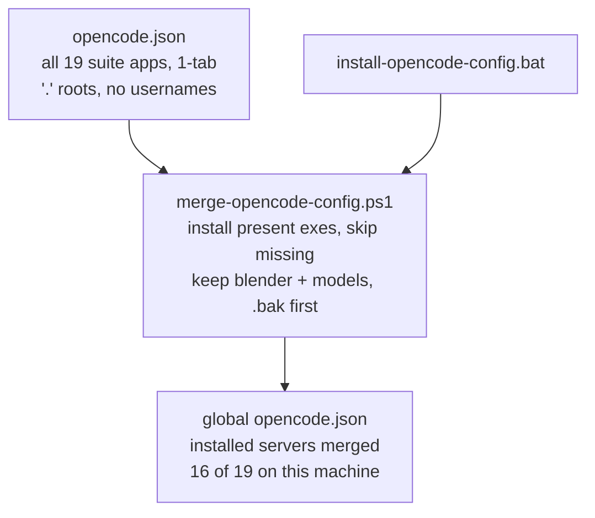
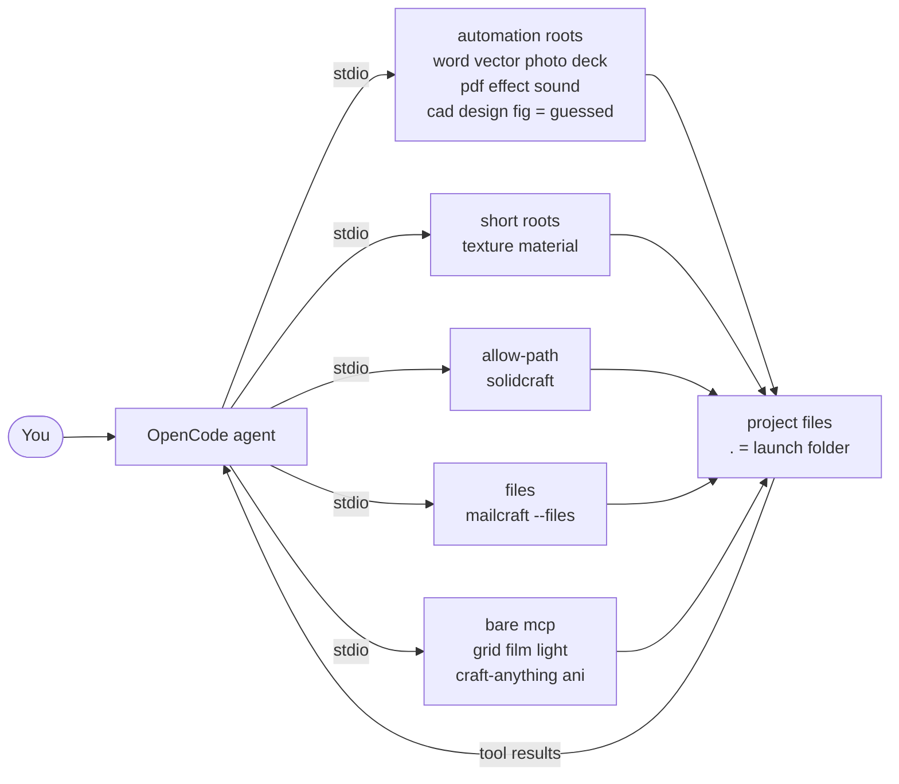
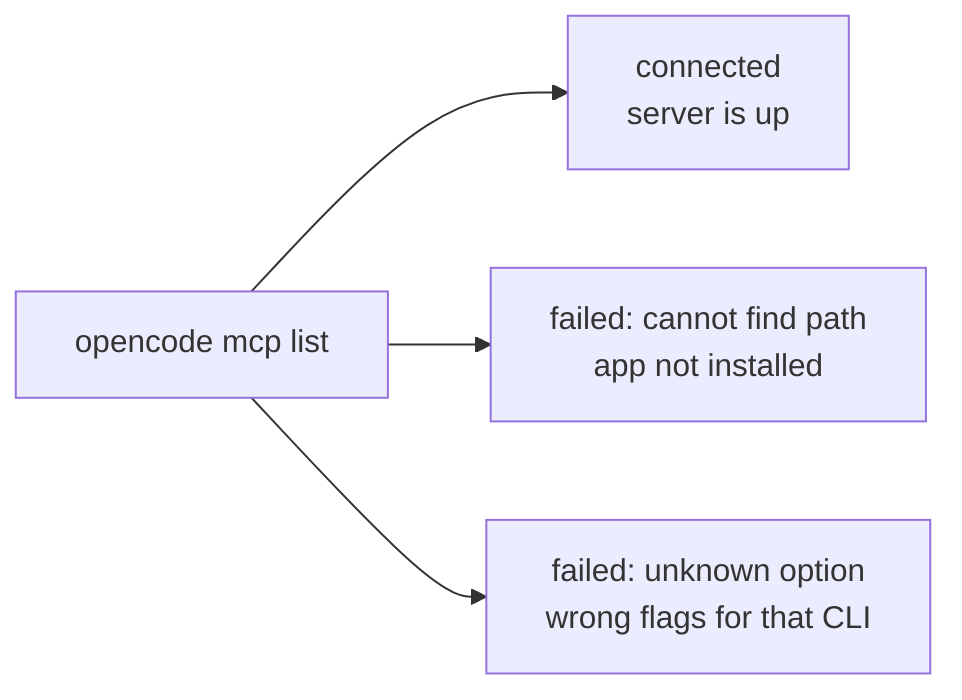

# ArtCraftMCP

> Drive your ArtCraft desktop apps with the OpenCode AI agent — over MCP.

[](https://github.com/storytold)
[](https://opencode.ai/docs/mcp-servers/)
[]()
[]()

**New here?** Install in under a minute: double-click `install-opencode-config.bat`, then run `opencode mcp list`. Every app installed on your machine should show green (17 here: 16 ArtCraft + blender). Entries for apps you don't have installed show `failed: system cannot find the path specified` — install the app or delete its block. Details in [troubleshooting](#troubleshooting).

---

## What this is

OpenCode is an AI coding agent. ArtCraft apps (WordCraft, VectorCraft, SolidCraft…) each ship a headless CLI that can act as a **Model Context Protocol (MCP) server**. This repo wires them together: one portable `opencode.json` covering **all 19 suite apps** as OpenCode tools, plus a one-click installer that discovers which ones exist on your machine and merges only those into your personal config.

**Install — from template to your machine:**



**Control — from agent to apps to files:**



**Verify — what the list tells you:**



In short: **OpenCode finds your apps** — not the other way around. Each entry in `opencode.json` tells OpenCode which executable to launch and which folders it may touch.

---

## What's in this repo

| File | What it does |
| ---- | ------------ |
| `opencode.json` | The portable template — all 19 ArtCraft servers, each with its own sandbox flags, `"."` roots, no hardcoded username. |
| `install-opencode-config.bat` | One-click installer. Discovers installed apps, merges them into your global config, backs it up first, then relaunches OpenCode. |
| `merge-opencode-config.ps1` | The merge engine behind the `.bat`. Installs only servers whose exe exists on disk, skips the rest, keeps everything else you already had. |

All JSON in this repo uses **1-tab indentation** as standard — including everything the merger writes.

---

## Quick start

### Option A — one click (recommended)

1. Double-click **`install-opencode-config.bat`**.
2. It backs up your current global config (`opencode.json.<date>.bak`), discovers which suite exes exist (16 of 19 on this machine), merges those in, and restarts OpenCode.
3. Run `opencode mcp list` — every installed app should be green:

```text
✓ anicraft       connected
✓ blender        connected
✓ craftanything  connected
✓ deckcraft      connected
✓ effectcraft    connected
✓ filmcraft      connected
✓ gridcraft      connected
✓ lightcraft      connected
✓ mailcraft       connected
✓ materialcraft   connected
✓ pdfcraft       connected
✓ photocraft     connected
✓ solidcraft     connected
✓ soundcraft     connected
✓ texturecraft   connected
✓ vectorcraft    connected
✓ wordcraft      connected
```

Your existing setup is safe: the merger **keeps** entries it doesn't know about (like `blender`) and your `model` / `small_model` choices. It only adds or refreshes ArtCraft servers whose exe is actually installed — the rest are reported as skipped and left untouched. Servers for apps you never installed show `✗ failed: system cannot find the path specified`; either install the app or delete its block from your copy.

### Option B — per project

Copy `opencode.json` into your project folder (where you launch `opencode` from). Project config overrides global where they overlap.

### Option C — manual merge

```bat
powershell -NoProfile -ExecutionPolicy Bypass -File merge-opencode-config.ps1 -Repo opencode.json -GlobalPath "%USERPROFILE%\.config\opencode\opencode.json"
opencode mcp list
```

---

## Prerequisites

- **OpenCode installed and on `PATH`.** Check with `opencode --version` in a fresh terminal. If it works there but not in your editor, **restart the editor** so it picks up the new `PATH`.
- **ArtCraft apps installed** under `C:\Program Files\<App>\`. The template covers all 19 suite apps; on this machine `CADCraft`, `DesignCraft` and `FigCraft` aren't installed, so the installer skips those three entries. AniCraft ships inside the suite folder (`C:\Program Files\ArtCraft\AniCraft\`) rather than in its own `C:\Program Files\AniCraft\` — the installer looks in both and rewrites the path to whichever exists.
- **Windows.** Your global config lives at `%USERPROFILE%\.config\opencode\opencode.json`.

---

## Compatibility matrix

Every ArtCraft CLI exposes `mcp`, but each one guards file access with **different flags**. Using the wrong flag is the #1 cause of `✗ failed` lines — 16 entries below were verified against that exe's real `mcp --help` output plus a spawn probe; the last 3 use the most common flag family as a best guess (those apps aren't installed here) and are marked accordingly.

| App | Command tail | Flag family |
| --- | ------------ | ----------- |
| wordcraft | `mcp --automation-read-root . --automation-write-root .` | automation roots |
| vectorcraft | `mcp --automation-read-root . --automation-write-root .` | automation roots |
| solidcraft | `mcp --allow-path .` | `--allow-path` (**only SolidCraft**) |
| photocraft | `mcp --automation-read-root . --automation-write-root .` | automation roots |
| gridcraft | `mcp` | bare — no root flags exist |
| deckcraft | `mcp --automation-read-root . --automation-write-root .` | automation roots |
| pdfcraft | `mcp --automation-read-root . --automation-write-root .` | automation roots |
| filmcraft | `mcp` | bare — headless or `--bridge` |
| lightcraft | `mcp` | bare — session flags only |
| effectcraft | `mcp --automation-read-root . --automation-write-root .` | automation roots |
| soundcraft | `mcp --automation-read-root . --automation-write-root .` | automation roots |
| texturecraft | `mcp --read-root . --write-root .` | short form, **no** `automation-` prefix |
| materialcraft | `mcp --read-root . --write-root .` | short form, same dialect as texturecraft |
| mailcraft | `mcp --files . --allow mailbox` | `--files DIR` — file sandbox; template also passes `--allow mailbox` so the agent can open mailbox files (send/delete/accounts/settings/input stay gated) |
| craftanything | `mcp` | bare — `--allow-run` is code-execution consent, not a path gate |
| cadcraft | `mcp --automation-read-root . --automation-write-root .` | guessed, unverified — app not installed here |
| designcraft | `mcp --automation-read-root . --automation-write-root .` | guessed, unverified — app not installed here |
| figcraft | `mcp --automation-read-root . --automation-write-root .` | guessed, unverified — app not installed here |
| anicraft | `mcp` | bare — no root flags exist; it reads and writes the paths the agent names, with your own permissions |

If you install one of those three, confirm its flags first with `"C:\Program Files\<App>\<cli>.exe" mcp --help` and correct the template if they differ — then re-run the installer. (`solvecraft-cli.exe` exists on disk but prints "deprecated, use solidcraft-cli", so it has no entry.)

Two layout notes for AniCraft: its CLI lives in the suite folder (`C:\Program Files\ArtCraft\AniCraft\anicraft-cli.exe`), not in a `C:\Program Files\AniCraft\` of its own, and the installer rewrites the entry to whichever of the two paths it finds. Its server also takes an optional document argument — `mcp` opens an empty one, `mcp --sample` opens the bundled sample, `mcp scene.anicraft` opens yours — so the template stays on the bare `mcp`.

---

## App sources on GitHub

Almost everything official lives under [@storytold](https://github.com/storytold) (the ArtCraft org, [getartcraft.com](https://getartcraft.com)) — each app has its own repo with releases, docs and an issue tracker. The exceptions are SolidCraft, a community app by [Tangency Labs](https://github.com/tangency-labs), and MailCraft, a community app ([ZIDAN44/mailcraft](https://github.com/ZIDAN44/mailcraft)). This config repo itself is [xevilmaxx/ArtCraftMCP](https://github.com/xevilmaxx/ArtCraftMCP).

| App | GitHub repo | Report a bug (#) |
| --- | ----------- | ---------------- |
| wordcraft | [storytold/wordcraft](https://github.com/storytold/wordcraft) | [#issues](https://github.com/storytold/wordcraft/issues) |
| vectorcraft | [storytold/vectorcraft](https://github.com/storytold/vectorcraft) | [#issues](https://github.com/storytold/vectorcraft/issues) |
| solidcraft | [tangency-labs/solidcraft](https://github.com/tangency-labs/solidcraft) (community app) | [#issues](https://github.com/tangency-labs/solidcraft/issues) |
| photocraft | [storytold/photocraft](https://github.com/storytold/photocraft) | [#issues](https://github.com/storytold/photocraft/issues) |
| gridcraft | [storytold/gridcraft](https://github.com/storytold/gridcraft) | [#issues](https://github.com/storytold/gridcraft/issues) |
| deckcraft | [storytold/deckcraft](https://github.com/storytold/deckcraft) | [#issues](https://github.com/storytold/deckcraft/issues) |
| pdfcraft | [storytold/pdfcraft](https://github.com/storytold/pdfcraft) | [#issues](https://github.com/storytold/pdfcraft/issues) |
| filmcraft | [storytold/filmcraft](https://github.com/storytold/filmcraft) | [#issues](https://github.com/storytold/filmcraft/issues) |
| lightcraft | [storytold/lightcraft](https://github.com/storytold/lightcraft) | [#issues](https://github.com/storytold/lightcraft/issues) |
| effectcraft | [storytold/effectcraft](https://github.com/storytold/effectcraft) | [#issues](https://github.com/storytold/effectcraft/issues) |
| soundcraft | [storytold/soundcraft](https://github.com/storytold/soundcraft) | [#issues](https://github.com/storytold/soundcraft/issues) |
| texturecraft | [storytold/texturecraft](https://github.com/storytold/texturecraft) | [#issues](https://github.com/storytold/texturecraft/issues) |
| materialcraft | [storytold/materialcraft](https://github.com/storytold/materialcraft) | [#issues](https://github.com/storytold/materialcraft/issues) |
| mailcraft | [ZIDAN44/mailcraft](https://github.com/ZIDAN44/mailcraft) (community app) | [#issues](https://github.com/ZIDAN44/mailcraft/issues) |
| craftanything | [storytold/craft-anything](https://github.com/storytold/craft-anything) | [#issues](https://github.com/storytold/craft-anything/issues) |
| cadcraft | [storytold/cadcraft](https://github.com/storytold/cadcraft) | [#issues](https://github.com/storytold/cadcraft/issues) |
| designcraft | [storytold/designcraft](https://github.com/storytold/designcraft) | [#issues](https://github.com/storytold/designcraft/issues) |
| figcraft | [storytold/figcraft](https://github.com/storytold/figcraft) | [#issues](https://github.com/storytold/figcraft/issues) |
| anicraft | [storytold/anicraft](https://github.com/storytold/anicraft) | [#issues](https://github.com/storytold/anicraft/issues) |

Also useful: [storytold/artcraft](https://github.com/storytold/artcraft) (the AI studio) and [storytold/craft-launcher](https://github.com/storytold/craft-launcher) (the app launcher). Found a wrong flag or a new app release that changed the CLI? Open an issue in the app's repo above, or in [this repo](https://github.com/xevilmaxx/ArtCraftMCP/issues).

---

## File access, simply explained

Each headless server is **sandboxed**: with no root flag it can't read or write your project files (symptom: SolidCraft saves landing in `Temp\solidcraft-mcp-…` with "Save to Downloads is blocked"). The template grants access with `"."`:

- **Portable** — no `C:\Users\<You>` inside, works for every user and checkout.
- **Follows you** — `"."` means "wherever you launched OpenCode".
- **Recursive** — subfolders like `.\projects\designs\part1.sc` are covered.
- **Repeatable** — most CLIs accept the flag more than once for several folders.

Need wider access? Replace `"."` with an absolute folder on the servers you want to widen. Prefer the smallest scope that works.

**AniCraft is the exception.** Its `mcp` server has no root flags at all — there is no sandbox to widen. It reads and writes the paths the agent names, with your own permissions, so scope it by asking for work inside a project folder. The engine's own guard is the `confirm: true` that destructive commands demand before they replace a file.

---

## Usage

```bat
opencode
opencode mcp list
opencode run "Export the current VectorCraft canvas to SVG"
opencode run --quiet "Parse input vectors from build/out.svg and feed coordinates to the cutting engine RPC on localhost:9000"
```

Headless, without MCP:

```bat
"C:\Program Files\WordCraft\wordcraft-cli.exe" run --file doc.docx --cmd "caret.docEnd" --save out.docx --print
```

---

## Troubleshooting

<details>
<summary><strong><code>opencode isn't installed or isn't on your PATH</code></strong></summary>

Run `opencode --version` in a **new** terminal. "Not recognized" means OpenCode isn't installed or its folder isn't in system `PATH`. If it works in a terminal but not inside your editor or the Craft Anything extension, **restart the IDE** — it inherited the old environment. Some extensions also have a setting for the explicit opencode binary path.

</details>

<details>
<summary><strong><code>'wordcraft-mcp-executable' is not recognized…</code></strong></summary>

That name is a placeholder from generic docs — no such binary exists. Point `command` at the real exe, e.g. `["C:\Program Files\WordCraft\wordcraft-cli.exe", "mcp", …]`. Keep each argument as its own JSON array element, especially paths with spaces.

</details>

<details>
<summary><strong>Every server shows <code>✗ failed … unknown option '--allow-path'</code></strong></summary>

`--allow-path` is SolidCraft-only. The other CLIs reject it (craft-anything even suggests `--allow-run`, which is unrelated — it gates code execution, not folders). Fix: use this repo's `opencode.json`, which carries the per-app flags from the [matrix](#compatibility-matrix), re-run the installer, then `opencode mcp list`.

</details>

<details>
<summary><strong>Saves land in <code>Temp</code>, destination "blocked"</strong></summary>

The server's sandbox doesn't include your destination. Either launch OpenCode in the destination's parent (roots are `"."`), or add that folder as a root flag for the server, then restart OpenCode so the server respawns with the new flags.

</details>

<details>
<summary><strong>Port already in use (<code>opencode mcp list</code>, <code>opencode reload</code>) / shows nothing</strong></summary>

A stale `opencode` background service is holding managed-service port 28894, so any command needing the service fails with `Failed to start server. Is port 28894 in use?`. Right after killing it, the first command may briefly say `No MCP servers configured` while the service reboots — just run it again. Find the squatter and stop just that process:

```bat
powershell -NoProfile -Command "Get-NetTCPConnection -LocalPort 28894 | Select-Object OwningProcess"
taskkill /F /PID <that-number>
opencode mcp list
```

</details>

<details>
<summary><strong><code>✗ failed: The system cannot find the path specified</code></strong></summary>

That app isn't installed where the template expects (`C:\Program Files\<App>\<cli>.exe`). This is normal for `cadcraft`, `designcraft` and `figcraft` on machines without them — and for any app when you run `opencode mcp list` from inside this repo (the repo template itself lists all 19 as project config). Either install the missing app or delete its block from your copy of `opencode.json`. For AniCraft, check the suite folder too: the CLI is at `C:\Program Files\ArtCraft\AniCraft\anicraft-cli.exe`, and the installer relocates the entry automatically if only that path exists.

</details>

<details>
<summary><strong>My <code>blender</code> server / model settings disappeared</strong></summary>

That was the old installer, which **overwrote** the global file. The current one **merges** and writes a timestamped `.bak` first. Restore from the `.bak` next to your global config, then run the new installer.

</details>

---

## References

- OpenCode config & precedence (`~/.config/opencode/opencode.json`, project `opencode.json`, `OPENCODE_CONFIG` overrides) — [opencode.ai/docs/config](https://opencode.ai/docs/config/)
- MCP servers (`type: local` + `command`, optional `cwd` / `environment` / `timeout`) — [opencode.ai/docs/mcp-servers](https://opencode.ai/docs/mcp-servers/)
- The `--allow-path`-everywhere claim from an earlier AI troubleshooting thread is **wrong** — 16 of the 19 [matrix](#compatibility-matrix) entries were verified exe-by-exe (the other 3 use the most common flag family as a guess), and `opencode mcp list` reports every installed server connected.
